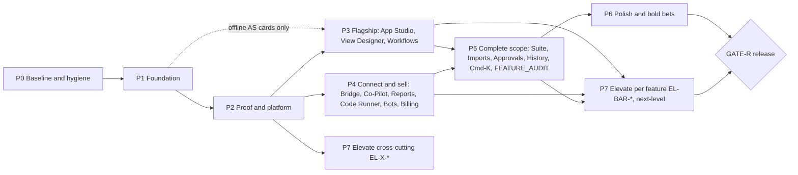

# 04 Phases: order, dependencies, entry and exit

Prefix → phase is `phase_map.json` (longest prefix wins). Card counts per phase and type are in `coverage/phases.md` (written by `tools/build_cards.py`). The master prompt §10 skeleton is followed; the two deviations are listed at the end with reasons.

## Dependency graph

Card-level `Depends on` lines are the real dependency graph; the phase graph is the coarse order. The Orchestrator never starts a card whose dependencies are not `done`, even inside an open phase.

## Concurrency rules

- At most **two phases active** at once, and only where the graph allows it (P3 ∥ P4; P7 feature cards ∥ the phase that built the feature).
- **Phase 3 offline App Studio cards** (no live Odoo, no write gate; e.g. AS-CONTRACT, AS-IR, oracles-only) may start once Phase 1 GATE-E passes. Cards that need L2-HARNESS wait for Phase 2.
- One Worker per file set (file-lock table in `STATE.md`). Two cards whose allow-lists overlap run in sequence, never in parallel.
- Weekly spend (`weekly_allocation` × (1 − `reserve_share`)) is split between the active phases in proportion to `budget.json` `phase_weights`.

## Phases

| Phase | Purpose | Entry | Main families | Exit (GATE-E plus) |
|---|---|---|---|---|
| **0 Baseline and hygiene** | Know exactly what works today; make tests trustworthy; stop the bleeding | G2 for phase 0 | B0 (inventory first, read-only), BL, NP-MERGE, REG-NP-*, test isolation + junk cleanup (GATE-D), distDir, Alembic drift, test-DB guard, every VERIFY for [Reported by Tope]/[Inferred], UI-AUDIT-ALL, REL-STATIC-WRITE | Suites green twice in random order; B0 inventory filed in `FACTS.md`; every VERIFY row measured |
| **1 Foundation** | The design system, shell and security baseline that every screen composes | P0 GATE-E; Grok pilot done (`05_MODEL_ROUTING.md`) | F1 (contrast, hydration, pagination, virtualisation, tokens, nav, switcher, Cmd-K, states), UI-REF-STUDY (before any ui-spec), UI-SHELL/CONNECT/HOME/F*/SP/EMPTY/CHARTS, SEC §6.1–6.3/6.7/6.10, V-AI, licence verifies | Contrast + axe + hydration crawl green on all routes, light and dark; switcher discovery < 10 s (3/3); GATE-B on every shell screen |
| **2 Proof and platform** | Turn "[Done, code]" into "[Done, live]"; Odoo 20; platform guarantees | P1 GATE-E | L2-HARNESS then L2-PROVE-*, `ir.access` shim, write gate / undo / idempotency / tenancy proofs, REL, ASVS L2, SBOM, OBS, BACKUP-PRERUN, CACHE-BATCH, O20-*, T2 JSON-2, T4, GND, DOC-SPEC, ADR | Live matrix 17/18/19/20 table in PROGRESS; zero "[Done, code]" left in P2 scope; ASVS checklist has no unowned gap |
| **3 Flagship** | App Studio v3 (Pack), View Designer (P1-6), Workflows/Wireframe (P1-8), P1-10 screen rebuilds | P2 GATE-E (live cards); G1B Pack approved | AS-* in Pack order (contract fix → stages behind flags → shadow → default), V-AS, REG-AS, UI-APPSTUDIO, VD, UI-VD, WF | Pack evaluation bars (`app-studio/00_PACK.md` §1 promise, §9 evaluation, §10 kill gates) met on fresh sessions; GATE-B on each P1-10 screen |
| **4 Connect and sell** | Everything that connects Ingenium to the outside and earns money | P2 GATE-E; GATE-A items (pricing, providers, Vexa) answered | BR (Bridge), CP (Co-Pilot), RD/PDF (reports), CR (Code Runner), T8/BOT/5C/L4 (bots), DEV, T6, BILL, WL, ONB | Bridge + Code Runner + bots proved live; billing in test mode end to end; first successful Check < 5 min |
| **5 Complete scope** | Every remaining approved item: Suite 1–48, FEATURE_AUDIT, approvals, history, imports | P3 and P4 GATE-E | SUITE, 5B, UI-S-*, IMP, APR, HIST, CMDK, HOME, CONN, FA (FA-S01..S21 itemised at this phase's G2), WEB, SET, NAV, CR-CLICK, CACHE-SEM, AGENT-RERUN (GATE-A) | Zero uncovered ledger rows for P5; wildcard rows itemised |
| **6 Polish and bold bets** | Touches, B1–B8, mobile, i18n, docs, telemetry, deploy and recovery drill | P5 GATE-E | TOUCH, BOLD, MOB, I18N, DOC, TEL, DEPLOY, BACKUP-DRILL, A11Y-VOICEOVER | Recovery drill timed and logged; docs site built |
| **7 Elevate** | Every feature raised to the Feature Excellence Bar, plus next-level features (DEC-045) | EL-X-* after P2; each EL-BAR-<feature> after that feature's phase | EL-X-*, EL-BAR-*, next-level EL-* | Each feature's bar scorecard green (`elevate/00_ELEVATE.md` §1) |
| **Release** | GATE-R | P6 and P7 GATE-E | — | Every §8.6 bar, §4 AC, ASVS L2, live 17–20 green, or Tope's written exception |

## Why this order

1. **Baseline before anything** (P0): 848 modified and 804 untracked files mean nobody knows what is green. Inventory is read-only and first; every later card cites it.
2. **Foundation before screens** (P1): tokens, states, tables and the switcher are built once and composed; doing screens first costs every screen twice (§9.5 step 2). The security baseline lands before more routes are added.
3. **Proof before flagship** (P2): App Studio, View Designer and Bridge all write to Odoo. The live harness, `ir.access` shim and write-gate proofs must exist so flagship cards can prove live instead of shipping "[Done, code]".
4. **Flagship and connect in parallel** (P3 ∥ P4): they share the platform but not files (the lock table enforces this). Billing waits on GATE-A, so it never blocks App Studio.
5. **Complete scope after** (P5): Suite and FEATURE_AUDIT items compose P1 components and P2 guarantees; they are many and small.
6. **Polish last, Elevate per feature** (P6, P7): next-level work on a feature starts only once its spec scope is done, so we never raise the bar on something unfinished.

## Deviations from the master prompt skeleton

| Deviation | Reason |
|---|---|
| Phase 7 Elevate added | Tope, 21 Oct (DEC-045): upgrade every feature beyond spec. Kept separate so spec scope is never blocked by proposals. |
| Reports (RD/PDF), Code Runner (CR), bots (T8/BOT/5C/L4), DEV modes in Phase 4 | They connect to the outside world (email, scripts, autonomous writes) and share Phase 4's guard work (SSRF, sandbox, L4 gates). CR-CLICK stays Phase 5 (P2-4). |
