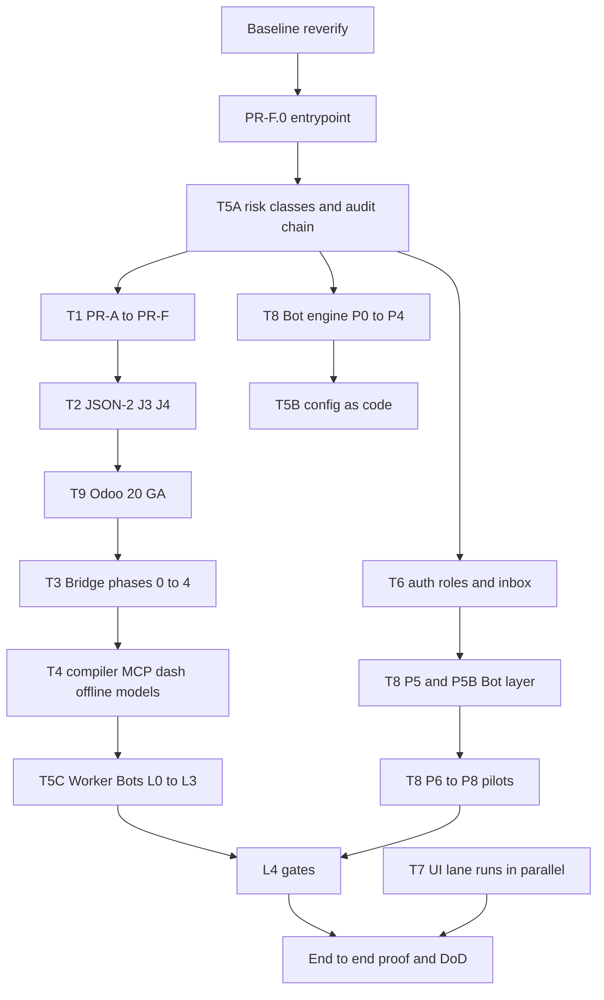

# Sequence

Do not start the next phase of a track until its gate is green. Parallel lanes are listed. Two parallel guardrail systems are forbidden: T5A builds the minimal core and T8 P3 extends that same core (master DoD 21).

## Global order

| Order | Track | Phase | Unblocks |
|---|---|---|---|
| 0 | BL | Baseline re-verify, request IDs, lint slots, ADR folder | everything |
| 1 | T1 | Pre-flight PF-1–PF-6 and PR-F.0 | PR-A |
| 2 | T5 | Phase 5A risk classes, dry-run hash, audit chain, snapshot-before-destructive | T6 inbox, T8 P3, T5B |
| 2b | T6 | 6B.1 roles already partly shipped; finish audit-chain hookup | inbox UI |
| 3 | T1 | PR-A → PR-F, then scrub retirement | T4 ISPEC |
| 4 | T2 | PR-J1 verify, then J2–J4 | Bridge Phase 0 |
| 5 | T9 | Odoo 20 GA (after JSON-2 transport is proven) | Bridge on 20, Designer on 20 |
| 6 | T3 | Bridge Phase 0 → 1 (Shopify I–III) | Phase 2 |
| 7 | T3 | Phase 2 → 4 (3b/3c, dead letter, catalog) | E2E step 4 |
| 8 | T4 | Live progress + MCP Phases 0–1 | may parallel with T1–T3 |
| 9 | T4 | AI Dashboard Studio | |
| 10 | T4 | Offline queue | may parallel |
| 11 | T4 | ISPEC / Recompile / Sync / browser agent | after T1 done |
| 12 | T4 | Wireframe-to-app | |
| 13 | T4 | Three-tier LLM | may parallel; D8 still open so the gateway card stops at ADR-02 |
| 14 | T4 | Skills / Sources / Triggers, including the stop-ship confirm gate | |
| 14a | T5 | Phase 5C Worker Bots L0–L3, then L4 cards | after T5A and one chassis |
| 14b | T6 | Command center live data from all five tracks | after auth isolation |
| 15 | All | End-to-end proof + DoD | last |

## Nested T8 order (inside the bot track, not instead of the table above)

T8 shares T5A. It does not rebuild classification.

P0 recon and ADRs → P1 LLM gateway (C01–C20) → P2 Odoo transport and SchemaGraph → P3 change-set engine (extends T5A) → P4 agent runtime → P5 API/UX approval page → P5B bot layer → P6 eval tiers (≥150 scenarios, ≥1 Tier A) → P7 hardening (RT-01–48, chaos, pen-test) → P8 pilot (3–5 pilots, 30 days, 0 critical) → then L4 cards if GATE-L4-08 evidence exists.

Phase 9+ (extra channels, vision, fleet) is backlog, not this phase, except Slack/Teams link-only approvals which are in P5B scope as links, not as approval buttons.

## T7 UI lane (parallel)

UI-F01–F12 (Base UI, Sonner, motion, tokens, shared states, page splits) start immediately. They do not wait for T5A.

A screen restyle card starts only after:

1. UI-F foundation for that component family is green, and
2. the feature card for that screen has its API contract, or the screen is restyle-only and the card says so.

Marketing (`/`, `/pricing`) uses the marketing skill set. Every operate screen uses dense-dashboard rules from `T7_UI_MOTION_COPY.md`.

PDF Studio (`cards/T7_PDF_STUDIO.md`, PDF-01–06) extends the existing reports editor. It may start after UI-F09. PDF-02 waits on UI-F13. PDF-03 waits on `report.inherit`. It does not wait on the rest of T8.

UI-F13 is the shared reorder primitive for the form designer, kanban, structure canvases, and printouts. UI-S-12 is the designer look-and-feel pass. It runs after UI-SP-DESIGNER and UI-F13. No separate designer-redesign track.

## Developer modes (queued 2026-10-04)

`cards/DEV_MODES_PRODUCTION.md`: DEV-CS, then DEV-SR, then DEV-PO. A customer can use Code Studio, Script Runner, and Power Ops without the founder. They wait until T6-06 is done. They do not start during that approval retarget. Promote stays a person. The hard stop stays out of the plan.

## Live schema context (cross-cutting)

`cards/T1_LIVE_CONTEXT.md` (GND-PKT through GND-GATE). GND-PKT starts after T1-A1. Every later LLM surface that names a model, field, method, or view anchor consumes that packet. GenerateIR admit rules stay.

## Harness lane (cross-cutting)

`cards/HARNESS.md` (H1–H8). H1 can start once one negative gate exists. It does not replace T8 eval scenarios or inline critique. PR runs of the active set stay cassette and property checks. Live judge and shadow runs are nightly and bounded. H6 does not wait on ADR-02.

## Dependency rules that override convenience

- Bridge Phase 0 waits for PR-J1.
- ISPEC waits for Track 1 done (compiler spec: do not start before Track 1).
- Wireframe never bypasses Stage H review. There is no code path around it.
- Trigger creation is confirmed once. Each firing re-enters the approval gate. No path treats "automation exists" as pre-approval.
- MCP writes stay impossible. A grep gate fails the build if a write-effect call goes through an MCP client.
- Odoo 20 `ir.access` work waits for T2 transport tests so JSON-2 named args are the 20 default.
- L4 cards wait for L3 evidence (GATE-L4-08). Do not stub the evidence.
- Client Approver isolation is already tested. Do not reopen it except to extend it to the new inbox.

## Mermaid

